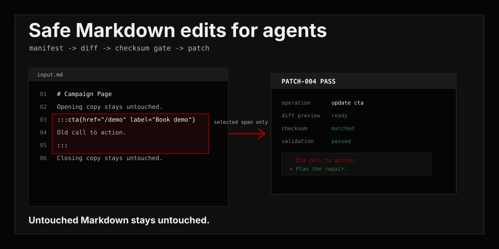
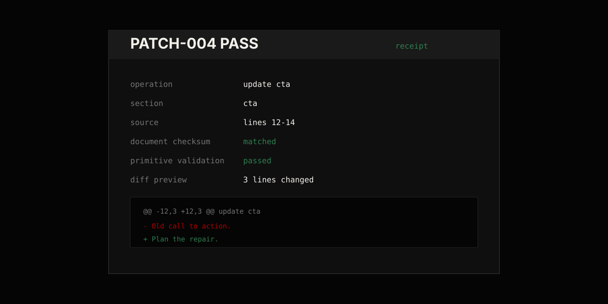
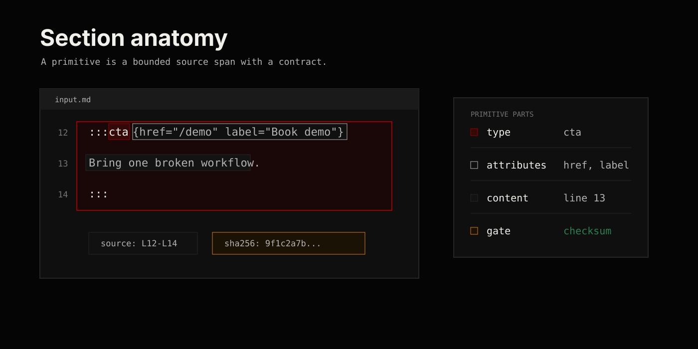
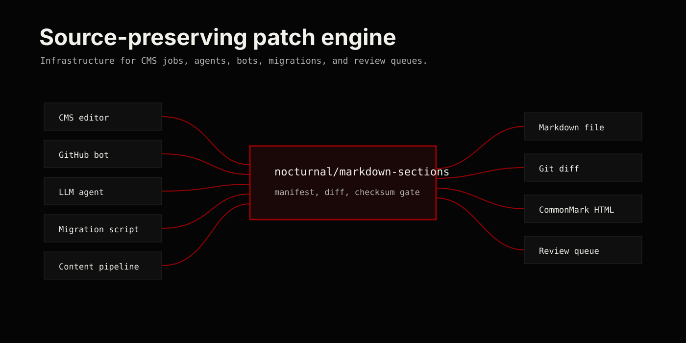

# nocturnal/markdown-sections



**Source-preserving Markdown section edits for PHP applications and agents.**

`nocturnal/markdown-sections` gives PHP applications a bounded editing surface inside Markdown. Parse named sections, explicitly validate contracts, preview diffs, and reject patches against changed source.

**Untouched Markdown stays byte-for-byte untouched.**

Optional League CommonMark integration renders sections as HTML.

`PHP 8.2+` · `League CommonMark 2.10.2+` · `source spans` · `SHA-256 checksums` · `patch previews` · `primitive validation`

## Install

The package is not on Packagist yet. Install the current development branch through Composer's VCS support:

```bash
composer config repositories.nocturnal-markdown-sections vcs https://github.com/iKnz990/markdown-sections
composer require nocturnal/markdown-sections:dev-main
```

While the repository is private, this requires a GitHub account with access. Composer records the resolved commit in your application's lockfile. Use a reviewed tagged version once one is available.

To contribute or run the examples:

```bash
git clone https://github.com/iKnz990/markdown-sections.git
cd markdown-sections
composer install
composer qa
```

Public GitHub access and Packagist registration are separate steps. A normal `composer require nocturnal/markdown-sections` install will work after the package is registered and a compatible release is available there.

## 60-Second Patch Demo

Save this as `demo.php` beside your application's `vendor/` directory and run `php demo.php`:

```php
<?php

require __DIR__ . '/vendor/autoload.php';

use Nocturnal\MarkdownSections\MarkdownSections;
use Nocturnal\MarkdownSections\Primitive\PrimitiveDefinition;
use Nocturnal\MarkdownSections\Primitive\PrimitiveRegistry;
use Nocturnal\MarkdownSections\Value\SectionAttributes;

$markdown = <<<'MD'
# Example

This introduction stays untouched.

:::cta{href="/contact" label="Contact"}
Tell us about your project.
:::
MD;

$registry = (new PrimitiveRegistry())->register(
    PrimitiveDefinition::type('cta')
        ->requireAttributes('href', 'label')
        ->rejectUnknownAttributes()
        ->requireContent(),
);

$document = MarkdownSections::parse($markdown);
if ($document->diagnostics() !== [] || !$registry->validate($document, reportUnknown: true)->isValid()) {
    throw new RuntimeException('Resolve parser or primitive issues before editing.');
}

$cta = $document->findByType('cta')[0];

$patch = $document->previewUpdatedSection(
    $cta,
    $cta->toDraft()
        ->withAttributes(SectionAttributes::fromArray([
            'href' => '/strategy',
            'label' => 'Plan the repair',
        ]))
        ->withContent('Bring one broken workflow. Leave with the fix mapped.'),
);

echo $patch->toUnifiedDiff();

$updated = $document->applyPatch($patch);
if ($updated->diagnostics() !== [] || !$registry->validate($updated, reportUnknown: true)->isValid()) {
    throw new RuntimeException('Reject the proposed edit before saving.');
}

echo $updated->toMarkdown();
```

The demo edits an immutable in-memory document and prints the result. Your application decides who may edit, whether the diff is approved, and how to save it safely.



## Why This Exists

Most Markdown packages optimize for parsing and rendering. That is useful, but it does not solve the dangerous part of agent workflows: unbounded mutation.

This package is a source-preserving patch engine for named Markdown primitives:

- parse sections such as `:::cta`, `:::faq`, `:::steps`, and `:::product-card`
- expose line numbers, byte offsets, raw source, and SHA-256 checksums
- validate project-defined primitive contracts
- preview exact patches before mutation
- reject stale edits when the document checksum changed
- update, remove, insert, or append sections without serializing the whole Markdown AST
- render through League CommonMark only when HTML output is needed

This is not a Markdown serializer. It is a bounded patch surface.

## Patch Workflow


The safe path is:

1. Parse Markdown.
2. Validate primitives.
3. Export a manifest.
4. Let the agent edit one section.
5. Preview the diff.
6. Check the document checksum.
7. Apply the patch to the current document snapshot.
8. Check parser diagnostics and validate the result before saving.

`applyPatch()` checks source identity; it does not automatically run a primitive registry. Use `validate($document, reportUnknown: true)` to reject unregistered section types as well. A manifest's `valid` flag reflects only the supplied registry's checks, not authorization or HTML safety.

## Primitive Contracts



Use primitive definitions when CMS jobs or LLM agents need guardrails.

```php
use Nocturnal\MarkdownSections\Primitive\PrimitiveDefinition;
use Nocturnal\MarkdownSections\Primitive\PrimitiveRegistry;

$registry = (new PrimitiveRegistry())->register(
    PrimitiveDefinition::type('cta')
        ->requireAttributes('href', 'label')
        ->optionalAttributes('variant')
        ->rejectUnknownAttributes()
        ->requireContent(),
);

$result = $registry->validate($document);

if (! $result->isValid()) {
    foreach ($result->issues() as $issue) {
        echo $issue->message . PHP_EOL;
    }
}
```

## LLM-Safe Edit Manifest

Agents get a manifest, not the source file.

```php
$manifest = $document->toEditManifest($registry);
```

Each section entry includes type, attributes, content, source span, checksum, validation state, and validation issues.

See [`docs/edit-manifest.schema.json`](docs/edit-manifest.schema.json) for the protocol shape.

## Source Preservation Contract


The contract is direct:

- Markdown outside the edited section span is copied byte-for-byte.
- Patches are tied to the document checksum that produced them.
- Applying a patch to a different document state throws.
- Section updates regenerate only the selected section block.
- Insert and append operations add generated section Markdown without reparsing unrelated prose.

Preservation contract tested: when a section changes, prefix and suffix remain byte-for-byte identical.

## Failure Modes

| Failure mode | Detected by | Result | Safe to retry |
| --- | --- | --- | --- |
| stale checksum | `DocumentPatch::applyTo()` | patch rejected | reload, review, and rebuild the patch |
| missing attribute | explicit `PrimitiveRegistry::validate()` | validation issue | after correcting input |
| unknown attribute | explicit validation with `rejectUnknownAttributes()` | validation issue | after correcting input |
| empty required content | explicit validation with `requireContent()` | validation issue | after correcting input |
| malformed section syntax | parser diagnostics | section ignored or diagnostic emitted | after correcting input |
| oversized document or section | parser limits | exception or diagnostic | after reducing input |

Parser diagnostics and primitive validation are separate checks. Validation can report no issues even when malformed or oversized sections were omitted by the parser; inspect both before accepting an edit.

## Insert And Append

```php
use Nocturnal\MarkdownSections\Value\SectionAttributes;
use Nocturnal\MarkdownSections\Value\SectionDraft;

$faq = new SectionDraft(
    'faq',
    SectionAttributes::fromArray(['title' => 'How does review work?']),
    'The patch is previewed before it is applied.',
);

$document = $document->withInsertedSectionAfter($cta, $faq);
$document = $document->withAppendedSection($faq);
```

These methods return new `MarkdownDocument` instances. The original document is not mutated.

## Syntax

- Opening fence: `:::type` or `:::type{key="value" key2=value}`
- Closing fence: a line whose trimmed content is exactly `:::`
- Type names may contain letters, numbers, `_`, and `-`
- Attribute values may be quoted or unquoted
- Quoted values support escaped quotes and backslashes
- Duplicate attributes are allowed; the last value wins

The source parser uses a line-based custom-fence grammar. It skips backtick/tilde fenced-code examples and opening fences indented as code. Use standalone section blocks in top-level document flow: this parser does not fully model CommonMark list, blockquote, or HTML-container contexts.

Inside a section, `:::` on its own line with at most three leading spaces closes the section unless it is literal code. Four-space or tab-indented markers remain code. Nested section fences are unsupported: parsed input reports a `nested_section` diagnostic, and generated `SectionDraft` content rejects opening or closing section fences outside code. Draft code fences must be balanced.

Malformed sections are ignored by default and exposed through diagnostics:

```php
$diagnostics = MarkdownSections::parse($markdown)->diagnostics();
```

## Rendering Via League CommonMark

Rendering is optional. Source safety is the point.

Register `MarkdownSectionsExtension` only when you need HTML output.

```php
use League\CommonMark\Environment\Environment;
use League\CommonMark\Extension\CommonMark\CommonMarkCoreExtension;
use League\CommonMark\MarkdownConverter;
use Nocturnal\MarkdownSections\CommonMark\MarkdownSectionsExtension;
use Nocturnal\MarkdownSections\Rendering\GenericSectionRenderer;
use Nocturnal\MarkdownSections\Rendering\SectionRendererRegistry;

$registry = (new SectionRendererRegistry())->withFallback(new GenericSectionRenderer());

$environment = new Environment([
    'html_input' => 'escape',
    'allow_unsafe_links' => false,
    'max_nesting_level' => 100,
]);
$environment->addExtension(new CommonMarkCoreExtension());
$environment->addExtension(new MarkdownSectionsExtension($registry));

$html = (new MarkdownConverter($environment))->convert($markdown);
```

Unknown section types use a safe escaped raw-source fallback unless you register a different fallback renderer.

The generic renderer passes through the child HTML produced by CommonMark. Configure CommonMark for untrusted input as above, review [its security guidance](https://commonmark.thephpleague.com/2.x/security/), and validate and escape values in custom renderers. Section attribute presence checks do not validate URL schemes or sanitize HTML.

## Where It Fits



Use it in CMS tasks, GitHub PR bots, AI content repair, static-site migrations, and content pipelines where "probably fine" is not good enough.

## Limits

Default limits for `MarkdownSections::parse()`:

- 1 MB maximum document size
- 100 sections per document
- 100 KB maximum content per section

The separate CommonMark rendering path uses CommonMark's configuration; these document-parser limits do not automatically constrain rendering.

## Safety Boundaries

- Checksums detect a different in-memory source snapshot. They do not authenticate agents, authorize edits, or prove that a proposal was approved.
- The library does not read, lock, or write files. Re-read the current stored source, apply the reviewed patch to that snapshot, and use application-level locking or compare-and-swap when persisting it. Applying to an old object cannot detect an external file change.
- Primitive definitions check declared attributes and content rules only when validation is called. Validate the proposed result and handle diagnostics before saving it.
- Rendering safety depends on CommonMark configuration and the registered renderers.

## More

- Exhaustive component usage: [`examples/README.md`](examples/README.md)
- Source preservation contract: [`docs/source-preservation-contract.md`](docs/source-preservation-contract.md)
- LLM editing workflow: [`docs/llm-editing-workflow.md`](docs/llm-editing-workflow.md)
- Primitive recipes: [`docs/primitive-recipes.md`](docs/primitive-recipes.md)
- Prior-art comparison: [`docs/comparison.md`](docs/comparison.md)
- Brand system and asset inventory: [`docs/brand-system.md`](docs/brand-system.md)

## License

The original package source and documentation are available under the [MIT license](LICENSE). Dependencies retain their own licenses and notices.
