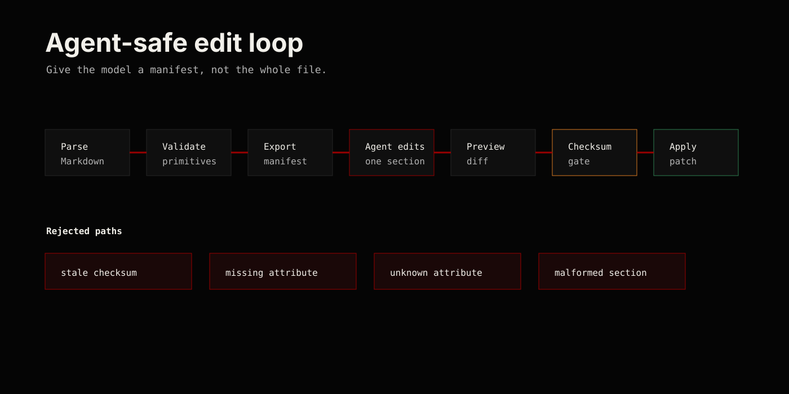

# LLM Editing Workflow

The safe path is to give an agent a manifest, not the whole file.



## Flow

1. Parse the Markdown.
2. Validate primitives with a `PrimitiveRegistry`.
3. Export `MarkdownDocument::toEditManifest()`.
4. Let the agent choose one section and return a proposed draft.
5. Build a `DocumentPatch`.
6. Show `DocumentPatch::toUnifiedDiff()` to a human or CI check.
7. Apply the patch only if the document checksum still matches.

The manifest shape is documented in [`edit-manifest.schema.json`](edit-manifest.schema.json).

## Why This Works

Markdown is easy for models to read, but broad document rewrites are risky. A primitive manifest narrows the task to a named block with attributes, content, source span, checksum, and validation issues.

The agent can edit the primitive. The application controls whether the patch applies.

## Recommended Agent Prompt Shape

```text
You may edit only one manifest section.
Keep the same section type unless asked.
Return attributes and content only.
Do not rewrite surrounding Markdown.
If validation issues exist, fix those first.
```

## Failure Modes To Keep

- stale checksum
- missing required attribute
- unknown attribute
- empty required content
- malformed section syntax
- patch rejected before write
