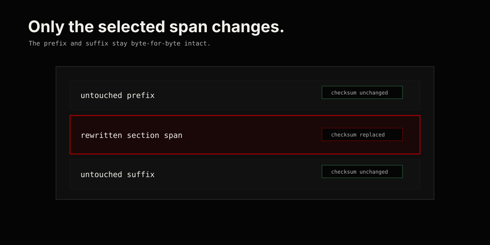

# Source Preservation Contract

`nocturnal/markdown-sections` is not a general Markdown-to-Markdown serializer.

The package rewrites known section spans and preserves everything else exactly.

## Guarantees

- Markdown outside an edited section span is copied byte-for-byte.
- A section exposes its source lines, byte offsets, raw source, and checksum.
- Patches are created against a document checksum.
- Applying a patch to a different document state throws an exception.
- Section updates regenerate only the selected section block.
- Removal deletes only the selected section block.
- Insert and append operations add generated section Markdown without reparsing unrelated prose.

## Non-Goals

- It does not normalize headings, lists, code fences, links, or prose.
- It does not promise full CommonMark AST round-tripping.
- It does not try to merge conflicting edits.
- It does not validate semantic meaning unless a primitive definition is registered.

## Review Rule

Every behavior change that touches rewriting should include a before/after test where surrounding Markdown remains unchanged.
